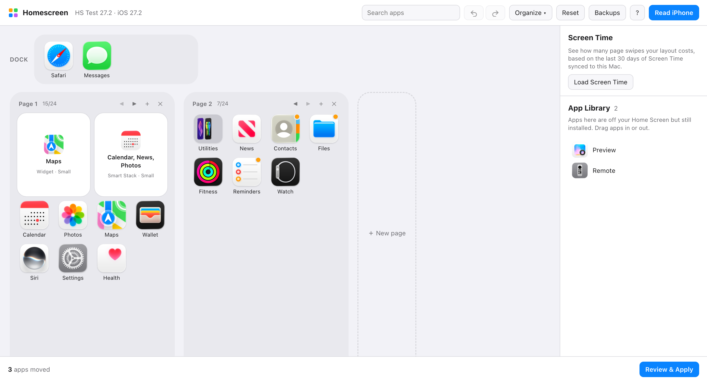

# Homescreen

**Arrange your iPhone Home Screen from your Mac.** Drag and drop with your real icons, sort by color or by how much you use each app, keep App Library apps where they belong, then apply the layout over USB. You can also let an AI assistant do the arranging through MCP.

Free and open source. Runs entirely on your Mac. No account, no server, no jailbreak.

<picture>
  <source media="(prefers-color-scheme: dark)" srcset="docs/app-dark.png">
  
</picture>

## Features

- **Drag-and-drop editor** on the real 4×6 grid: your phone's real icons, widgets at their real sizes, folders (several pages each), the dock, and page add/move/delete.
- **Gaps (empty spaces).** Drop an app on any empty spot to place it exactly there. Homescreen writes the gap to the phone and remembers it, so it survives later edits.
- **Widgets keep their settings** (which script, which person, which city) through every apply.
- **App Library that stays put.** Apps you keep only in the App Library stay there when you apply, and you can drag apps into or out of it. Most tools get this wrong ([why](#why-other-tools-dump-app-library-apps-onto-your-home-screen)).
- **App Bank** to park apps, folders or widgets while you rearrange.
- **One-click organizing:**
  - by color
  - A–Z
  - by App Store category
  - **by Screen Time usage**: moves your most-used apps onto the first pages, with an estimate of how many page swipes that saves
- **Undo/redo** for every change, multi-select, search, and swap (⌥-drop).
- **Safe apply:**
  1. Nothing reaches the phone until you review and apply.
  2. Your current layout is backed up first.
  3. The result is read back and verified.
  4. A failed write is never blindly retried.
  5. Any backup can be restored in one click.
- **AI assistant (MCP):** 28 tools so Claude (or any MCP client) can read, rearrange, sort and explain your layout. Writing to the phone stays off unless you enable it.
- **CLI** for scripting: `homescreen read | show | diff | apply | backups | restore | probe | ui`.

## Requirements

- A Mac with Python 3.11+ (developed on Apple silicon; Intel should work but is untested).
- An iPhone connected by USB and trusted ("Trust This Computer").
- Tested with iOS 27.0.1 (iPhone 17 Pro Max) and the iOS 27.2 simulator. Other versions may work; the safety checks will tell you if a write didn't land as planned.

## Install

```bash
pipx install git+https://github.com/kats1123/homescreen-mcp
```
(or `python3 -m pip install --user git+https://github.com/kats1123/homescreen-mcp`)

## Use it

```bash
homescreen ui
```
Your browser opens the app at `http://127.0.0.1:8765`. Then:
1. Plug in your iPhone, unlock it and click **Read iPhone**.
2. Rearrange.
3. Click **Review & Apply**.

Before a big rearrangement, **unhide any hidden Home Screen pages** on the phone (long-press the Home Screen, tap the page dots). iOS doesn't report which pages are hidden, so apps could otherwise end up on a page you can't see.

**Screen Time:** turn on *Settings › Screen Time › Share Across Devices* on the iPhone and the Mac. The app reads the synced history locally, which needs **Full Disk Access** for the Terminal you run `homescreen` from (System Settings › Privacy & Security).

## Let an AI assistant arrange it

Add the MCP server to Claude Code:
```bash
claude mcp add homescreen -- homescreen-mcp
```
or to Claude Desktop (`claude_desktop_config.json`):
```json
{ "mcpServers": { "homescreen": { "command": "homescreen-mcp" } } }
```
Then ask things like *"organize my apps by color"*, *"put the apps I use most on page 1"* or *"file my loose apps into folders that make sense"*.

The assistant edits a draft. You apply it in the app (`homescreen ui`, then Review & Apply) or with `homescreen apply <token>`. To let the assistant apply by itself, start the server with `HOMESCREEN_ALLOW_APPLY=1`.

## Why other tools dump App Library apps onto your Home Screen

Found by reading SpringBoard's code in the iOS 27.2 simulator, then confirmed on a real iPhone:

1. Over USB, SpringBoard's `getIconState` only returns a **list**: `[dock, page 1, page 2, …]`. There's no App Library in it, in any `formatVersion`.
2. Writing that list back with `setIconState` reaches `-[SBIconController importIconState:]`. `+[SBIconStateArchiver rootArchiveFromITunesRepresentation:]` turns the list into `{buttonBar, iconLists}` and nothing else.
3. Every installed app the layout doesn't mention is then **put on a page**. Writing back an *unchanged* layout moved 33 App Library apps onto a phone's Home Screen.

**What Homescreen does instead:** SpringBoard's import also accepts its own on-disk dictionary form, which has the App Library as `ignored`. Homescreen sends:
- `buttonBar` and `iconLists`, with apps as bundle-id strings, folders with their contents, and widgets unchanged.
- `ignored`: the App Library. USB can't read it, so it's computed as installed apps (including offloaded ones), minus apps on the Home Screen, minus hidden and system-only apps.

**Widgets keep their settings.** A configured widget (which script, which person, which city) is linked to its settings by an element ID. Over USB that ID only appears as `userSelectedElementIdentifier`. Writing a widget without it as `uniqueIdentifier` makes SpringBoard save the widget with no ID, and its settings are orphaned. Homescreen sends it back, and remembers each widget's ID across reads in case iOS drops one. Verified on iOS 27.0.1: a configured Scriptable widget kept its script through a write.

Keys it leaves out (Today View, page IDs) keep their values on the phone. Any installed app that isn't listed anywhere goes to the App Library, never onto a page.

`tools/sbhelper/` contains the simulator harness used to work this out. It feeds layouts to the simulator's SpringBoard through the same import path a USB write takes.

## How it works

- **[pymobiledevice3](https://github.com/doronz88/pymobiledevice3)** talks to the phone over USB:
  - `com.apple.springboardservices` for the layout and icons
  - `installation_proxy` for the installed apps
- **Nothing is rebuilt.** Each app, folder and widget keeps its original data, and edits only move it around. Unknown fields go back untouched.
- **Validation** runs before every apply:
  - page capacity: 24 slots; small/medium/large widgets take 4/8/16
  - dock of 4, and folders of 9 per page
  - no folders or widgets inside folders
  - no item lost or duplicated, and an empty App Bank
- **Screen Time** comes from the Biome `App.InFocus` streams macOS keeps for synced devices. Page swipes are estimated as page *N* costing *N−1* swipes, plus folder pages, with the dock free.
- **Local only.** The app listens on 127.0.0.1, and every change request needs a per-launch token. The one optional network call is *Group by App Store category*: it sends bundle IDs to Apple's public lookup API, asks first, and caches the results.

Data (drafts, backups, icon cache) lives in `~/Library/Application Support/homescreen-mcp`.

## Gaps and hidden pages: what iOS allows over USB

- **iOS stores gaps as pinned cells for each page** (`listMetadata` → `fixedLocations`), keyed by page ID.
- **Writing gaps works.** Homescreen sends page IDs plus the pins and verifies the result. Tested on iOS 27.0.1 and the iOS 27.2 simulator.
- **Reading them doesn't.** None of SpringBoard's USB exports (`getIconState` in any `formatVersion`) includes gaps or hidden pages. They only return the order of icons. And a write without them clears every gap, even on pages nobody touched.
- **What that means in practice:**
  - **Gaps set in Homescreen** are remembered for each phone and sent with every write, so they last.
  - **Gaps made on the iPhone itself** can't be seen, so they close on the first apply. Recreate them in Homescreen (drop the app on that spot); the Apply screen warns about this.
  - **Hidden pages** are likewise invisible over USB. Unhide them before applying.

## Limitations

- Hidden pages and gaps made on the phone itself can't be read (see above).
- Assumes the iPhone grid: 4×6 pages and a 4-icon dock. iPad isn't supported yet.
- A few system apps that iOS never shows on the Home Screen are listed in `NEVER_ON_HOME_SCREEN` (`homescreen/device.py`). If a write reports one under `added_by_ios`, add it there.

## Development

```bash
git clone https://github.com/kats1123/homescreen-mcp && cd homescreen-mcp
python3 -m venv .venv && .venv/bin/pip install -e '.[dev]'
.venv/bin/python -m pytest -q tests
```
- Without a phone: `HOMESCREEN_FIXTURE=<layout.plist> homescreen ui`. Build a test layout with `python tests/fake_phone.py fake.plist --dict`.
- On a booted simulator: `HOMESCREEN_SIM=booted homescreen ui`.

## Disclaimer

Not affiliated with, endorsed by or sponsored by Apple Inc. iPhone, iOS and Screen Time are trademarks of Apple Inc. This tool uses private device interfaces that can change with any iOS update. It backs up before every write and verifies after, but you use it at your own risk; keep your own iPhone backups too.

## License

MIT. See [LICENSE](LICENSE).
